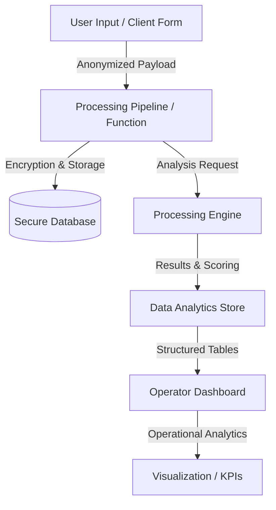
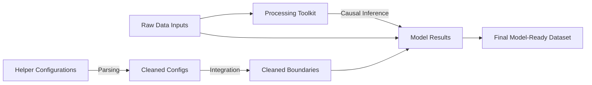

# 🏗️ Technical System Designs & Architecture

High-level architectural breakdowns of technical systems designed, built, or managed by you.

---

## 🤖 1. [System Name, e.g., Automated Triage Platform]

[Provide a 2-3 sentence overview of the system, its objectives, and key requirements.]

### Key Components
- **Ingestion & Data Anonymization**: [Describe the ingestion process, databases used, and security/privacy boundaries.]
- **Processing Engine**: [Describe the backend analysis process or algorithms used.]
- **Data Analytics & Dashboarding**: [Describe how the data is stored, aggregated, and surfaced to operators/users.]

---

## 🗺️ 2. [System Name, e.g., Spatial Analysis Toolkit]

[Provide a short description of the library or service design.]

### Key Algorithms & Systems
- **Module A**: [Explain specific algorithms or math models implemented in this component.]
- **Module B**: [Explain how data cleaning or formatting is automated.]
